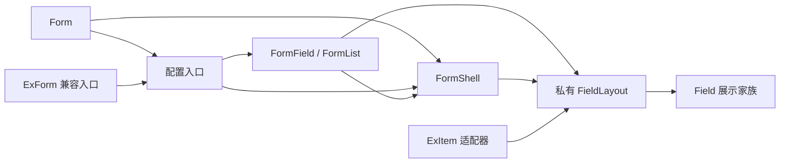

# RFC：统一 Form API 与字段文档体系

- 日期：2026-10-19
- 状态：实现就绪设计，尚未实施；本文不构成实现、发布或宿主验收证据
- 批准来源：[表单收敛规格](../specs/2026-10-19-form-api-consolidation-design.md)已由用户在 2026-10-19 确认；源文件保留原快照，不改写其审阅前状态
- 模块根目录：`.notes/ex-form/`
- 责任边界：组件模块负责 API、类型和展示壳；文档模块及维护脚本负责规范页面、迁移页、示例、搜索和生成契约

## 1. 决策与范围

推荐公开面收敛为 Field 展示家族与 Form 状态家族。Form 支持组合式、外部实例配置式和内部实例配置式三个严格入口；FormField 接替 FormItem；ExItem 的展示外壳转为私有共享实现。旧名称、旧类型、旧文档与稳定分享地址通过兼容层继续可用。

本 RFC 是已批准规格的单一实施交接，不重新选择 Form / ConfigForm 等备选方案。必须联合交付 API、兼容层、双语文档、示例、消费 skill 和验证。以下设计不涉及替换 RHF、改变校验协调器、增加可视化编辑器、升级 ReUI、迁移其他家族或执行发布。

## 2. 当前结构与实施约束

当前事实及对实现的影响：

| 证据 | 实施约束 |
| --- | --- |
| [form.tsx](../../../packages/components/src/components/patterns/form.tsx)同时定义 Form、FormShell、RetainStepFieldsContext 和列样式工具；[FormList](../../../packages/components/src/components/patterns/form-list.tsx)等反向导入这些工具 | 先拆私有 FormShell，再让 Form 导入配置渲染器，避免根组件与子字段循环导入 |
| [ex-form.tsx](../../../packages/components/src/components/patterns/ex-form.tsx)已有实例入口、schema 入口、配置递归和步骤控制 | 提取和复用现有实现，不复制控制器或创建第二份草稿 |
| [类型文件](../../../packages/components/src/lib/forms/types.ts)公开 FormProps interface、相关字段类型；[包根](../../../packages/components/src/index.ts)显式导出 | 保留旧 interface 和泛型；新分支类型与弃用声明均显式导出 |
| [ExItem](../../../packages/components/src/components/patterns/ex-item.tsx)负责直接 Input 的有限属性补全；[FormItem](../../../packages/components/src/components/patterns/form-item.tsx)负责字段绑定和错误 | 展示壳下沉不改变关联规则；Field 自身不增加表单状态 |
| [catalog.ts](../../../packages/docs/src/showcase/catalog.ts)是原始家族库存；[loadCatalog](../../../scripts/docs-examples.mjs)将其转译后通过 data URL 导入 | catalog.ts 保持自包含，不能直接新增站点契约的相对运行时 import；展示派生逻辑放入单独模块 |
| [页面宿主](../../../packages/docs/app/components/ComponentExamplesHost.tsx)按原 group 选择示例模块；[总览](../../../packages/docs/src/showcase/ComponentsOverview.tsx)也使用 group | URL/模块归属与导航分类必须分开，不能直接把 Form 的 group 改成 components |
| [分享导出](../../../scripts/docs-sharing.mjs)依赖拥有 Preview 的函数及 pages 登记；[片段生成](../../../scripts/docs-snippets.mjs)默认截取前三个短属性 | 聚合页面、示例所有权、源码提取和关键属性摘要需要一起调整 |
| [当前搜索适配](../../../packages/docs/app/routes/search.ts)使用 createFromSource | 已检查安装版本 fumadocs-core 16.17.4：buildIndex 必须返回索引，不能返回 null 来过滤页面；使用公开 createSearchAPI 的显式索引入口 |

只读库存核对得到 91 个原始家族，其中 Components 86 个、ExUI 5 个；双语文档共 202 页。收敛后保留全部原始家族和文档地址，规范可见家族为 89 个：Components 87 个、Blocks 2 个。数量通过库存和映射派生；测试同时保留对当前预期数量的断言，不能把丢页变成新的正确结果。

## 3. 规范 API 与类型设计

### 3.1 Form 重载

以下是规范签名，具体声明由实施产生并经公共包编译验证：

```ts
export function Form<const S extends FormSchema>(
  props: FormConfiguredSchemaProps<S>,
): React.ReactElement

export function Form<I extends FormValues, O>(
  props: FormConfiguredInstanceProps<I, O>,
): React.ReactElement

export function Form<I extends FormValues, O>(
  props: FormComposedProps<I, O>,
): React.ReactElement
```

三分支的必需和禁止属性如下；禁止项必须用 never 等显式关系约束，而不是只依赖对象字面量额外属性检查。

| 分支 | 必需 | 禁止 |
| --- | --- | --- |
| FormComposedProps<I, O> | form、onSubmit、children | schema、defaultValues、fields、steps、currentStep、onStepChange、footer、全部配置按钮文案、stepsAriaLabel、mode、reValidateMode |
| FormConfiguredInstanceProps<I, O> | form、onSubmit、fields | schema、defaultValues、mode、reValidateMode |
| FormConfiguredSchemaProps<S> | schema、defaultValues、onSubmit、fields | form |

配置按钮文案包括 submitLabel、resetLabel、backLabel、nextLabel。配置分支的公共部分命名为 FormConfiguredCommonProps<I, O>；其字段、步骤、页脚参数继续使用 NoInfer 和按路径分配的类型，不能因重载而扩大推导。

配置式 fields 为 readonly FormFieldConfig<NoInfer<I>>[]。外部 form 决定 I/O；schema 入口由 FormInput<S>/FormOutput<S> 决定。默认值、路径、控件和观察值遵循 Input，提交结果遵循 Output。schema 对象不用于推导 UI 控件。

children 在配置分支只作生成字段之前的摘要和说明插槽，原有顺序是步骤导航、children、字段或 review、页脚。任意 ReactNode 内部是否创建字段无法由类型证明；不增加 children 反射，不支持把配置字段和组合字段作为两个并行的声明入口。需要自由穿插时使用组合式。

### 3.2 过渡类型

从现有 FormProps 提取一个不依赖 ExItem 命名的内部公共属性结构，供新分支与旧声明复用。旧 FormProps<I, O> 必须继续是 interface，保留所有既有属性、必需性和两个泛型参数；标记弃用并指向 FormComposedProps。不要将 FormProps 变为整个 Form 的联合类型，也不要在旧 interface 上增加 fields 等新入口。

FormFieldProps<I, O, P> 取代 FormItemProps 的推荐名称，保留显式 form、合法路径、control / render 互斥、children?: never。新增 FormFieldLayout、FormFieldSpan 和 FormFooterArguments<I>；新公共声明不能依赖 ExItemProps、ExItemLayout 或 ExItemSpan。

旧 FormItemProps、ExFormCommonProps、ExFormSchemaProps、ExFormInstanceProps、ExFormFooterArguments、ExItemProps、ExItemLayout、ExItemSpan 均保留结构和泛型。旧 interface 保持可被 interface extends 的形态，同形 type 可改为 @deprecated 别名。对通用 JSX 包装器，文档指导选择具名分支 props，不把 React.ComponentProps<typeof Form> 描述为全部重载的通用联合。

## 4. 组件分派、依赖方向和失败行为

### 4.1 私有模块布局

| 文件 | 职责 |
| --- | --- |
| `components/patterns/form.tsx` | 公开 Form 重载、入口断言和渲染方式守卫 |
| `components/patterns/form-shell.tsx`，新增 | 原 FormShell、FormRouting、RetainStepFieldsContext、formColumnStyle；只在内部导出 |
| `components/patterns/form-configured.tsx`，新增 | 从 ex-form.tsx 提取配置渲染、schema owning 组件、递归字段和步骤接线 |
| `components/patterns/form-field.tsx`，新增 | 原 FormItem 的规范实现，绑定逻辑保持 |
| `components/patterns/form-field-layout.tsx`，新增 | 无状态展示壳和展示上下文，承接 ExItem 的 DOM、有限 Input 补全与布局 |
| `components/patterns/ex-form.tsx` | 两个旧配置重载的兼容入口 |
| `components/patterns/form-item.tsx` | 指向 FormField 的弃用值别名，保持组件引用相同 |
| `components/patterns/ex-item.tsx` | 原 ExItem 接口及兼容适配器，委托私有展示壳 |

FormList 和 FormField 对共享工具的导入改为 form-shell.tsx；FormShell 只依赖表单私有 context、展示上下文和公共类型，不回头导入 Form、配置渲染器、字段或列表。类型依赖使用 import type。



图中的 Binding 到 Shell 表示使用其私有 Context/工具，不表示再渲染一个 FormShell。每个入口恰好挂载一个原生 form、一个 FormShell 和一个持有中的 owner。

### 4.2 入口算法

1. 从 fields !== undefined 判定配置式；[] 仍为配置式。非数组的 fields、同时传 form/schema、缺少必需来源等 JS 误用抛出带 ExUI Form 前缀的明确配置错误。
2. Form 无条件持有一个初始“配置式/组合式”引用。后续改变该种类时抛出配置错误，要求改变 key；错误不是表单验证 issue，也不调用业务 onSubmit 或伪装成失败提交。
3. 组合式把合法公共属性和 children 交给唯一 FormShell；不生成页脚。
4. 配置式的 form 来源进入同一个 ConfiguredForm；schema 来源进入独立 owning 组件，由其调用 useForm 后进入同一个 ConfiguredForm。
5. 配置字段继续使用现有路径验证、递归列表和作用域转换，步骤继续委托现有 FormStepsController，不复制 coordinator。

form/schema 来源在配置式内部切换时，保持当前 ExForm 的子树身份规则：直接 ConfiguredForm 与 schema owning 子树之间正常卸载/挂载，清理旧连接。不要把来源选择写入上述“配置/组合”守卫，使旧 ExForm 的合法来源切换变成新增错误。同一 schema owning 子树内的 schema 引用检查沿用 useForm。

ExForm 兼容入口直接委托共享配置入口，保留原两个重载；不能简单导出 ExForm = Form，否则旧 API 会意外接受组合式。FormItem 使用带 @deprecated 的 `const FormItem: typeof FormField = FormField` 或等价同一引用声明，不能套一层会改变组件身份的 React 包装器。

### 4.3 行为保持

原 Form 的 noValidate、阻止原生 reset、禁用和 aria-busy 规则保持。配置式默认操作、footer=null、resetLabel 可选、受控步骤确认、最后一步完整校验、错误定位和 FormErrorSummary 显式插入保持。原内部 CSS 类、data-slot、data-span 和 data-item-layout 保留，不复制新旧两套样式。

reset、cancelPending、卸载与 Dialog 清理的效果遵循既有契约；取消只阻止旧结果写回并发出合作式 signal，不撤回已经发送的业务操作。别名和适配器不输出运行时弃用日志，不产生新的 SSR/hydration 副作用。

## 5. Field 展示与 ExItem 迁移

私有展示壳保留当前 ID 和描述合并、controlId 冲突检测、标题/说明共用区域、错误在控件下方、布局继承、内容宽度和对齐。FormField 持有真实控件的绑定、aria-invalid、aria-required、描述/错误 ID 和焦点 ref；展示壳不访问表单 store。

独立 Field 推荐配方放入既有 `skills/exui/examples/form-item-layout.tsx`，并由新的 `skills/exui/references/exui/field-layout.md` 解释；Field 参考的受控生成段链接到此说明。它是消费文档和组合源码，不增加另一个公开包装组件。

配方必须提供可直接消费的 TSX。需要容器规则时使用示例自身作用域的 style 内容或已被分享导出器纳入的本地样式，不能要求消费者导入私有组件路径或在唯一允许 TSX 的 skill examples 目录放入未登记 CSS。样式遵循：

- 标题/描述区域采用 .25rem 间距，纵向字段区域 .5rem，横向标题与控件 .75rem。
- 横向标题基准 9rem，控件基准 12rem，保持 flex-wrap；以单项 21.75rem 容器条件应用内容最大宽度和左右对齐。
- 内容最大宽度仅约束内容块，不约束外部可换行槽；更窄时恢复完整可用宽度。数字最大宽度按 CSS 像素，字符串按 CSS 长度解释。
- 不复用公开 FieldGroup 的 responsive 断点去替代以上单项规则；Field 当前 orientation 的行为不变。

交互 Input 使用稳定 ID、htmlFor 和 aria-describedby；有额外描述引用时合并而非覆盖。说明与错误各有 ID，无效状态在真实控件上。Switch、Select 触发器或包装控件按真实焦点元素关联。FieldTitle 只用于不承担控件标签的标题，静态 review 可以使用语义化信息列表。

旧 ExItem 的自动关联由兼容适配器完整保留；新手写示例、规范示例与导出源码使用 Field 组合。几何和关联测试比较这两个路径，不能仅断言它们有相同 class。

## 6. 单一文档兼容映射

### 6.1 数据位置与接口

在既有 `packages/docs/lib/site-contract.mjs` 增加表单文档覆盖记录与纯函数，并同步其 `.d.mts` 声明。以下记录是权威来源；普通页面默认以自身为规范目标、按原 URL group 展示。

| document ID | kind | canonicalId | navigationGroup | visible | searchAliases |
| --- | --- | --- | --- | --- | --- |
| components/field | canonical | components/field | components | true | ExItem |
| exui/form | canonical | exui/form | components | true | ExForm、FormItem |
| exui/ex-form | migration | exui/form | components | false | 空 |
| exui/ex-item | migration | components/field | components | false | 空 |

纯函数 `getDocumentPresentation(id)` 返回 canonicalId、navigationGroup、visible、kind 和 searchAliases。迁移示例所有权通过 `canonicalDocumentId(id)` 或等价函数解析。入口验证使用现有 document ID 规则；校验规范目标存在、两语言都有内容且映射无循环。不要额外维护隐藏页面列表和搜索重定向列表。

catalog.ts 的原 group、module、families 和原始 catalogPages 保持；新增 `src/showcase/catalog-presentation.ts` 读取原库存及站点映射，派生 canonicalCatalogPages 和单项展示属性。该模块可以有正常相对 import，原库存文件不能增加运行时 import，保证 loadCatalog 的 data URL 加载继续工作。

### 6.2 内容、导航与总览

内容清单仍要求 91 个家族地址和十个指南的双语覆盖。仅两个显式 migration 地址允许省略 exampleFamily，并必须省略以防加载旧 gallery；其他家族仍要求匹配，其他指南仍禁止声明。映射不写进双语 frontmatter，避免重复维护；现有字段 schema 无需扩展。

documentTree 以 getDocumentPresentation 过滤和分组，URL 仍用原 document ID。ComponentsOverview 与总览计数使用 canonicalCatalogPages 的 navigationGroup；预览及详情页示例加载继续使用原 group/module。Form 卡片进入 Components，链接仍为 exui/form，其预览继续由手写 ExUI 模块提供。

原始覆盖 91、可见 89、Components 87、Blocks 2 的预期同时验证。已有旧 Showcase 路由和原始例子库存继续识别旧家族；默认导航隐藏迁移记录。更新总览和静态验证中的明确预期，不删除覆盖断言。

## 7. 旧页面、锚点与查询参数

ExForm、ExItem 的双语 MDX 改为迁移页，保留所有旧标题 ID。实施在修改前生成并提交固定锚点回归清单 `scripts/fixtures/form-legacy-document-anchors.json`，测试不根据已经改过的迁移页重新接受基线。当前应包含：

| 页面与语言 | 原锚点，另含 examples |
| --- | --- |
| ex-form / zh-CN | exui-能力、配置式-exform、基本用法、当前示例源码摘录、相关指南 |
| ex-item / zh-CN | exui-能力、独立的-exitem、基本用法、当前示例源码摘录、相关指南 |
| ex-form / en | exui-capabilities、configured-exform、basic-usage、current-example-source-excerpt、related-guide |
| ex-item / en | exui-capabilities、standalone-exitem、basic-usage、current-example-source-excerpt、related-guide |

以上需以实际构建后的 heading ID 复核；有差异先修正固定清单，再修改正文。保留旧标题可以使用其原有标题文字并放置迁移说明；需要显式 examples 标题时，路由 loader 同步把该锚点加入 toc 和 alternateAnchors，内容链接检查也识别此显式兼容锚点。

在 docs 路由增加迁移提示组件，从 loader 的映射结果和分享库存生成普通 anchor 链接。对旧 ExForm 列出 exui-ex-form-1，对旧 ExItem 列出 exui-ex-item-1/2/3；链接使用规范 docPath、当前 locale/base 和原 example 参数。无脚本 HTML 就包含全部可用链接，客户端仅按查询参数突出当前链接，不能依赖客户端跳转才能访问。

不要在 MDX 中硬编码带查询参数的 Markdown 链接，也不要为此全局放宽现有内容检查对问号的限制。带 example 的链接由上述可服务端渲染的组件生成，并由静态验证检查其 pathname 和已登记 ID。

已知旧 example 不显示“未找到示例”；未知或属于其他家族的 ID 提供明确反馈，不选择第一个示例冒充定位。普通地址、带尾斜杠地址、锚点、语言切换、查询参数和两个部署 base 都须验证。迁移页没有旧 gallery，但仍正常 SSR/预渲染，不依赖服务器重定向或 SPA fallback。

## 8. 示例所有权、聚合和分享导出

### 8.1 稳定 ID 与新宿主

| 稳定 ID | 原始所有者 | 规范所有者 |
| --- | --- | --- |
| exui-form-1 | exui/form | exui/form |
| exui-ex-form-1 | exui/ex-form | exui/form |
| exui-ex-item-1、exui-ex-item-2、exui-ex-item-3 | exui/ex-item | components/field |

新增的最小对照示例使用新的手写 ID，并进入能力清单；不得复用锁定上游 c-* ID。规范 Form 页面包含组合式、配置式和现有步骤场景；每个交互示例持有独立实例，避免聚合后一个实例连接两个 Form。

### 8.2 手写 Form 页面与源码提取

将当前 FormPage、ExFormPage 拆为顶层的单示例叶组件和聚合页面，叶组件拥有 Preview 和本地状态。规范 FormPage 聚合这些叶组件；旧 Showcase 的 ex-form 登记仍可只显示配置式叶组件。

分享提取器不能继续要求每个拥有 Preview 的叶组件都直接出现在 pages 映射中。对手写 ExUI Preview，以已有 shareId 的 `exui-<原家族>-...` 约定匹配原始 catalog 的 ExUI 家族，再用单一兼容映射得出规范所有者；匹配必须唯一，无匹配、重复 ID 或无法解析来源立即失败。保留 functionName 指向实际叶函数，让依赖闭包提取仍能生成独立消费源码。此规则只用于手写 ExUI 例子，不改变上游 c-* 库存解析。

### 8.3 Field 扩展示例

将三个 ExItem 展示例子迁为 Field 的三个手写默认导出模块，接入 `examples/field/exui-extensions.ts`，保留历史 ID。Field 家族通过已有生成器的 extensions 机制合并这些例子；不手改 index.generated.ts 或固定 c-field 源。

原 ExItemPage 改为复用这些扩展示例的旧夹具入口，不能继续含同 ID 的另一组 Preview，否则分享发现重复。Form review 中的 ExItem 同步迁为 Field/静态信息组合。兼容 ExItem 的实际 API 验证留在专门夹具，不在新导出源码里继续推荐。

### 8.4 分享链路一致性

loadShareExamples 完成发现后统一规范化 page 所有者。保留 example.id、源函数/文件信息和所有独立 HTML、source.md、source.json 路径；类型声明、源 JSON 的 family 字段、分享页返回文档链接、页面示例列表、计数、搜索和 source drawer 使用同一规范结果。

不能让 loader 宣称某 ID 已属于 Form/Field，而宿主页面实际没有其卡片。分别用真实 ComponentExamplesHost 和构建后的独立分享页验证 ID 定位及源码加载；不以 mocked fetch 的夹具替代这些证据。

## 9. 搜索、片段和能力生成

### 9.1 搜索索引

改用当前公开的 `createSearchAPI("advanced", { indexes })`。每语言从 source.getPages() 读取页面，先排除 kind=migration，再构造完整 AdvancedIndex；沿现有数据来源保留 structuredData，并追加规范家族全部示例 ID 和 searchAliases 为可索引正文。所有索引 URL 使用 docPath，不能返回迁移地址。

此选择基于已安装 16.17.4 的公开声明及实现；不得导入带哈希的内部文件、对 loader 做不完整代理、把 buildIndex 强断言为可返回 null，或升级依赖绕过过滤。搜索仍按现有路由返回 staticGET 产物。面包屑从当前显示分组生成，复用导航分组文案，Form 显示 Components。

验收至少包括两种语言搜索 ExForm、FormItem、ExItem，功能结果只指向规范 Form 或 Field；迁移页不能出现为另一套表单功能。其他页面的可搜索正文和路径继续保留。

### 9.2 源码摘录

firstFamilyExampleId 仍按原 URL group/exampleFamily 找规范页首例：Form 是 exui-form-1，Field 是 c-field-1。迁移页不生成源摘录；其正文中保留旧摘录标题作为迁移锚点。

familySourceDocuments 的固定 91 判断改为从可见规范家族集合派生，并验证集合精确相等、当前数量为 89。能力关联例子仍额外进入完整源码编译，不能因只有 89 个首例而漏掉配置和三个 Field 扩展。

修正摘要器对 Form/FormField 的关键属性选择：Form 保留 onSubmit、form 或 schema/defaultValues，配置式额外保留 fields；FormField 保留 form、name、control 或 render。不能被“最多三个属性”和“超过 90 字符忽略”的通用规则删掉。手写示例把长配置命名为 fields 等局部变量以改善摘录；完整模块和相关声明由 verify/分享源码提供，不伪造属性值。

### 9.3 能力与 skill

- form-lifecycle 指向规范 Form，覆盖 FormField、新分支类型和仍存在的 FormItem 兼容符号，sources 更新到新文件。
- configured-forms 的主说明移到规范 Form；保留旧 ExForm 的兼容关联和迁移页 guide，使历史已审导出仍有解释。
- standalone-ex-item 保留能力 ID 表达兼容行为，主说明与迁移配方放 Field；pages 至少同时包含规范 Field 和迁移 ExItem，因为其历史示例已经规范归属 Field。双语文本明确区分推荐配方与旧适配器。
- 为所有新增公开类型补齐能力关联；不要将一批表单导出笼统排除。生成块只能由已有脚本生成，原始第三方参考正文和上游锁保持。
- `skills/exui/SKILL.md`、`references/exui/form.md`、新的 `references/exui/field-layout.md`、三个现有表单示例和生成库存一起更新。旧名称只出现在迁移说明或兼容验证中。
- 完成源码和说明审查后才执行现有 --accept-source-review；普通生成不得自动接受来源漂移。

## 10. 验证矩阵与执行边界

执行规范以 [TESTING.md](../../../TESTING.md)为准。本 RFC 的检查未运行未来实现；下表定义实施必须通过的证据。

| 类别 | 正向和反向要求 | 位置 |
| --- | --- | --- |
| 新类型 | 三分支准确推导 Input/Output；spread 变量上的非法混用也拒绝；空 fields 合法；错误路径、控件、枚举和数组类型拒绝 | 现有隔离 form-consumer-fixture 与两个固定 Zod 消费者 |
| 旧类型 | interface extends FormProps 和 ExItemProps 继续编译；旧泛型调用及旧组件导出可用；FormItem 与 FormField 同引用 | packed consumer 的兼容部分 |
| 根及生命周期 | 单一原生 form/owner、组合式不加页脚、配置页脚各分支、分支切换错误、key 重挂载、schema/form 来源切换、取消和重置 | 现有 Form、FormAsync、FormSteps 浏览器测试 |
| 控件与展示 | 同一绑定和草稿；日期、文件、动态列表、错误摘要；独立 Field 与旧 ExItem 的几何和 aria；SSR 无浏览器全局依赖 | FormControls、FormSurfaces、FormSurfaceOutline、FormContentSizing、ExItem 测试及 pack |
| 映射和库存 | 原始 91 与规范 89 集合、导航分组与 URL 分离、只允许两个 migration 家族没有 exampleFamily、无循环/缺失规范目标 | docs-content、docs-sharing 及站点契约 Node 回归 |
| 页面与分享 | 固定锚点、已知/未知旧查询、locale/base、规范 gallery 真正包含历史 ID、source drawer 和三种分享资源 | docs 静态/分享检查与真实页面宿主浏览器用例 |
| 搜索 | 旧名称命中规范功能页，迁移页不重复出现，索引 URL 与示例计数正确 | 静态索引生成回归及真实搜索对话框 |
| 文档和 skill | 摘录保留关键属性、完整模块可编译、新公开名称均有能力解释、无私有路径依赖 | snippets、capabilities、skill references/examples 门禁 |

至少覆盖 light、dark、pitch-black，标准/紧凑密度、窄容器和根字号缩放的既有相关用例。没有视觉变化时不重录基线；失败先查真实行为，不通过接受新截图抹去差异。源码重命名本身不需要复制一套只比字符串的测试。

## 11. 依赖顺序、生成与落地

按以下顺序实施，各步是同一交付的依赖阶段，不是要求单独发布或自动提交：

1. 冻结旧公共类型和旧页面锚点的兼容反例；提取 FormShell、展示壳及新类型，建立 FormField 和弃用入口；验证原行为仍成立。
2. 提取共享配置入口、实现 Form 三分支及运行时守卫；接入新旧公开导出，跑针对性类型、生命周期和展示验证。
3. 建立站点兼容映射与库存派生层，联合迁移示例、分享所有权、页面宿主和目录分类；再改旧 MDX 为迁移页及搜索索引。
4. 更新能力片段、skill 和完整示例；复审来源后执行生成；运行当前依赖顺序下的所有相关门禁并添加 minor Changeset。

主要命令沿用现有入口，不新增重复框架：

```text
pnpm tokens:check
pnpm typecheck
pnpm lint
pnpm build
pnpm test:visual
pnpm verify:pack
pnpm docs:content:check
pnpm test:docs-content
pnpm test:docs-sharing
pnpm docs:snippets:verify
pnpm docs:static:verify
pnpm docs:sharing:verify
pnpm docs:examples:check
pnpm upstream:check
pnpm test:docs-capabilities
pnpm docs:capabilities:check
node scripts/exui-skill/sync-references.mjs --check
node scripts/exui-skill/update-inventories.mjs --check
node scripts/exui-skill/verify.mjs
node scripts/exui-skill/verify-examples.mjs
```

写入型生成按真实修改调用：docs:examples:generate 生成扩展登记，docs:content:generate 生成清单，`node scripts/docs-snippets.mjs --write` 生成摘录，docs:capabilities:generate 和 skill inventory 的 --write 更新其受控产物。源码/能力说明复审后先用 --accept-source-review 接受已审实现，再执行依赖它的能力生成。不是所有生成器都需要运行；不得运行 lock/rebase 等重新接受上游身份的模式。

上述 check 的最终结果必须来自生成完成后的匹配产物。build/typecheck 及依赖同一生成目录的任务顺序执行。完成 `/` 站点构建与验证后，再设置 EXUI_DOCS_BASE=/exui/ 构建 docs，并对这份产物运行对应 static/sharing 验证；不能拿后一份产物报告前一前缀的成功。

本地代码门禁应按贡献要求使用 Node.js 24、pnpm 11.9.0；本文编写时环境 Node 22 仅用于只读源码/库存核对，不构成 Node 24 或 CI 通过证据。

## 12. 兼容窗口、停止条件和回退

当前公开包版本为 1.0.0。此次以兼容新增发布至少一个次版本周期：新增推荐 API，所有旧导出及结构继续工作，仅声明弃用。未来移除旧名称需要另一次主版本决策。Changeset 为唯一公开包 @exre/exui 记录 minor 变更，不执行 version-packages、推送或发布。

以下任一情况阻止交付：旧合法类型不再编译、旧页面/分享资源失效、状态核心出现第二份值存储、焦点或 aria 退化、示例数量与实际 gallery 不一致、两个 base 验证不匹配、来源快照未经审查。保留旧实现直至规范入口与兼容层联合通过，不先发删页或删符号的半成品。

回退以该完整变更集为单位，恢复原导出、内部接线、清单、示例登记和文档产物；生成目录通过旧生成器重建，不手改 dist/types/build。已发布后以正常修复版本恢复接口，不覆盖既有包版本。浏览器外部业务提交不可由组件回退撤销，原取消与数据边界不变。

## 13. 风险、取舍与规格覆盖

| 风险 | 处理和检测 |
| --- | --- |
| 统一 Form 引入循环依赖、重复 owner | 私有 Shell 的单向模块图；真实实例、卸载和单根测试 |
| 重载或弃用声明破坏泛型/interface | 旧 interface 保留；正负编译例子和 skipLibCheck=false |
| 导航分类挪动导致加载错误模块 | 保留原 group/module，用派生 navigationGroup；生产宿主与总览验证 |
| 原 catalog 新 import 导致 Node 维护脚本无法加载 | catalog 自包含，额外派生模块；真实 loadCatalog 回归 |
| 聚合后的叶组件无法独立导出，或分享 ID 重复 | 原家族推断与规范所有权分离；源码闭包编译、唯一性和 HTTP 资源测试 |
| 只隐藏迁移页而搜索仍重复出现 | 先筛选索引集合，旧词进入规范正文；静态搜索和对话框验证 |
| 去掉 ExItem 简写丢失说明或布局 | 兼容适配器、完整消费配方、几何/aria 对照 |
| 摘录再次删掉必需参数 | Form/FormField 关键属性规则；生成回归与完整公共消费编译 |

已批准的 A 优于保留 Form / ConfigForm 双入口或只改文档，代价是三个严格重载、独立字段组合代码增加和更完整的迁移链路。对这些已批准取舍不再重新选型。

| 来源规格章节 | 本 RFC 的实施契约 |
| --- | --- |
| 1—3，方向、证据、范围 | 1—2 |
| 4，公开入口与类型 | 3 |
| 5，内部结构与生命周期 | 4 |
| 6，Field / ExItem | 5 |
| 7，过渡窗口 | 3—4、12 |
| 8，文档与分享 | 6—9 |
| 9，验收 | 10—11 |
| 10—11，风险与交付 | 11—13 |

未决架构问题：无。本 RFC 不改变来源规格的批准范围。生产实现、验收、发布和后续主版本移除仍未发生。来源规格与旧 RFC 保留；新的稳定知识仅在维护者允许沉淀后通过 codebase-documenter 更新 `.ai/`，本轮不将计划写成当前事实。
