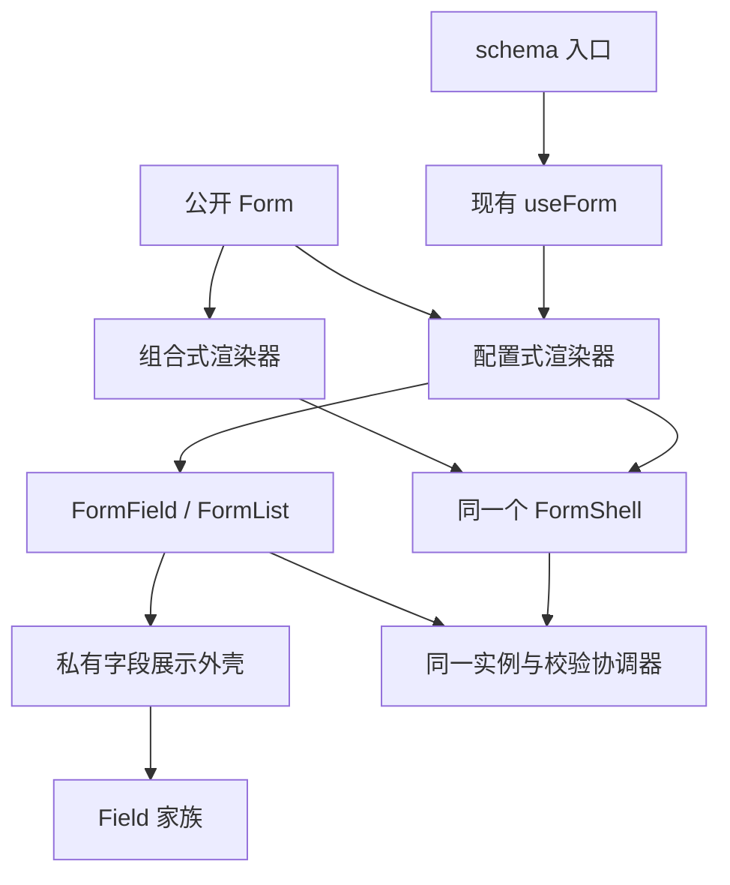

# 表单 API、字段展示与文档入口收敛设计

- 日期：2026-10-19
- 状态：方案 A 已确认；本规格待用户审阅，尚未实施
- 模块根目录：`.notes/ex-form/`

## 1. 决策摘要

使用者目前需要区分 Field、ExItem、FormItem、Form 和 ExForm。实现已经共享展示组件及状态核心，公开名称和文档分类却没有表达这些关系。

本次将推荐使用面收敛为两套：Field 家族负责不绑定表单状态的展示，Form 家族负责草稿、校验、字段绑定和提交。Form 同时提供组合式和配置式入口，FormField 取代 FormItem；ExItem 的展示外壳改为内部共享实现。

用户已经确认方案 A 的上述方向。本规格补齐类型、生命周期、兼容、文档和验收契约，供完整设计审阅；方向确认不等同于本规格或实现已获批准。

| 当前入口 | 推荐入口或处理方式 |
| --- | --- |
| Field 及其展示子组件 | 保留，支持独立展示、手工组合和外部表单库 |
| ExItem | 停止作为推荐的独立公开家族；保留过渡适配器，展示外壳下沉内部 |
| FormItem | FormField；旧名称保留同一实现的弃用别名 |
| Form、ExForm | 统一为 Form 的组合式、配置式分支；ExForm 保留配置式兼容入口 |
| FormList、FormErrorSummary、useForm 及同源 hooks | 保留，统一放入 Form 家族说明 |

## 2. 当前证据与外部参考

### 仓库事实

- [Form 实现](../../../packages/components/src/components/patterns/form.tsx)直接使用私有 FormShell；[ExForm 实现](../../../packages/components/src/components/patterns/ex-form.tsx)也使用该外壳，额外管理字段配置、步骤和页脚。
- [ExItem](../../../packages/components/src/components/patterns/ex-item.tsx)组合 Field 家族；[FormItem](../../../packages/components/src/components/patterns/form-item.tsx)组合 ExItem 和 FieldError，并连接表单实例。
- [公开类型](../../../packages/components/src/lib/forms/types.ts)中，FormProps 是 interface；FormItem 的显式 form 是字段路径和值类型的推导来源。不能假定 JSX 父组件的泛型会自动传播给子组件。
- [表单架构](../../../.ai/architectures/components/forms.md)和[生命周期约束](../../../.ai/knowledge/components/forms-lifecycle.md)约定同一状态核心、Standard Schema V1、输入和输出分离、异步结果写入守卫。名称调整不构成重写这些机制的理由。
- [文档清单校验](../../../scripts/docs-content.mjs)目前要求组件家族路径与 exampleFamily 一一对应；[分享导出器](../../../scripts/docs-sharing.mjs)从家族登记和 Preview 的稳定 ID 提取示例。隐藏菜单、合并页面与保留分享链接必须一起处理。
- [现有展示边界决策](../../../.ai/decisions/components/07-ex-item-presentation-boundary.md)要求展示与字段状态分离。本设计保留这个边界，重新选择其公开面；已有决策和历史规格在本轮保持原文。

### 外部参考及适用边界

以下参考已在本次讨论中查阅，记录日期为 2026-10-19。它们说明可借鉴的职责划分，不承诺 ExUI 与其 API 兼容。

| 来源 | 经核查的处理方式 | 本次采用的启示 |
| --- | --- | --- |
| [ReUI Field](https://reui.io/components/field)、[当前 Form Blocks](https://reui.io/blocks/application/form) | Field 承担字段展示；Form Blocks 是可连接业务状态和提交逻辑的完整页面组合 | 区分展示组件、表单状态入口与业务页面示例 |
| [ReUI v1 Form](https://v1.reui.io/docs/form) | 旧版 Form 以 RHF、Zod 组织表单 | 旧版 Form 与当前 Form Blocks 不能作为同一个 API 引用 |
| [shadcn 表单指南](https://ui.shadcn.com/docs/forms/react-hook-form) | Field 与 RHF Controller 等状态绑定组合 | 展示层保持独立；状态绑定复用展示组件 |
| [Ant Design Form](https://ant.design/components/form/)、[ProComponents SchemaForm](https://procomponents.ant.design/components/schema-form/) | Form / Form.Item 与配置生成层分工 | 配置生成可以是独立层，但不必拥有另一套状态 |
| [Mantine useForm](https://mantine.dev/form/use-form/) | 状态管理可独立于其 UI 输入组件使用 | 不把字段展示强制绑定到一种表单实例 |

线上参考与仓库固定 ReUI revision 是不同证据。本次不升级上游、不改写锁定示例，也不照搬网页中未经本地源码验证的自动关联宣称。

## 3. 范围、目标与非目标

必须实现的结果：

1. 新用户从一个 Form 页面找到组合式、配置式、动态列表、步骤、错误和生命周期说明。
2. 新示例统一使用 Form、FormField；推荐 API 中不再用 Ex 前缀区分表单能力。
3. 字段配置、JSX 组合和兼容入口使用同一表单核心、同一绑定实现和同一展示外壳。
4. 旧名称、类型、文档地址和示例分享地址在过渡版本继续有效。
5. 保持现有输入/输出类型、安全校验、异步仲裁、布局及可访问性行为。

不属于本次范围：替换 RHF、公开裸 RHF 实例、增加外部状态库适配、自动从任意 schema 推导 UI、可视化表单编辑器、远端 schema、重做其他 Blocks 的分类、调整无关组件、升级 ReUI 或重新发布包。

## 4. 公开 API 契约

### 4.1 一个 Form，三个合法入口

| 分支 | 必须传入 | 可选内容 | 禁止混入 |
| --- | --- | --- | --- |
| 组合式 | form、onSubmit、children | 既有公共布局、错误显示与生命周期属性 | schema、defaultValues、fields、steps、配置式页脚属性、根级 mode / reValidateMode |
| 配置式，外部实例 | form、onSubmit、fields | children、steps、自定义 footer、按钮文案及公共属性 | schema、defaultValues、根级 mode / reValidateMode |
| 配置式，内部实例 | schema、defaultValues、onSubmit、fields | children、steps、footer、mode、reValidateMode 及公共属性 | form |

fields 不为 undefined 时选择配置分支，空数组仍是配置式。没有 fields 时只能使用组合式实例入口。schema 只负责校验和类型，不负责猜测字段、标签或控件。

配置式的 children 保留当前 ExForm 的意义：在生成字段之前放入摘要、说明等辅助内容。它不是第二套字段声明入口；需要在任意位置穿插绑定字段时，使用组合式。ReactNode 无法静态证明任意自定义组件是否会创建字段，本次不增加递归探测 children 或另一套字段登记系统。

组合式不自动生成按钮。配置式沿用现有默认提交按钮、可选重置按钮和步骤操作；footer 为 null 时隐藏页脚，为函数时接收同源状态和导航操作。两种分支均不自动插入 FormErrorSummary。

不增加名为 mode 的渲染模式开关，避免与校验时机重名。

### 4.2 完整使用形态

以下展示拟议 API，尚未通过未来公开产物编译；实施时必须进入现有公共包示例门禁。三个组件各自创建或拥有实例，互不共享一个已挂载表单实例。

```tsx
import {
  Button,
  Form,
  FormErrorSummary,
  FormField,
  useForm,
} from "@exre/exui"
import { z } from "zod"

const projectSchema = z.object({ name: z.string().trim().min(1) })

export function ComposedProjectForm() {
  const form = useForm({ schema: projectSchema, defaultValues: { name: "" } })
  return (
    <Form form={form} onSubmit={(value) => console.log(value.name)}>
      <FormErrorSummary title="请检查以下字段" />
      <FormField form={form} name="name" label="项目名称" control="text" />
      <Button type="submit">保存</Button>
    </Form>
  )
}

export function ConfiguredProjectForm() {
  return (
    <Form
      schema={projectSchema}
      defaultValues={{ name: "" }}
      fields={[{ name: "name", label: "项目名称", control: "text" }]}
      submitLabel="保存"
      onSubmit={(value) => console.log(value.name)}
    >
      <FormErrorSummary title="请检查以下字段" />
    </Form>
  )
}

export function ConfiguredProjectWithInstance() {
  const form = useForm({ schema: projectSchema, defaultValues: { name: "" } })
  return (
    <Form
      form={form}
      fields={[{ name: "name", label: "项目名称", control: "text" }]}
      submitLabel="保存"
      onSubmit={(value) => console.log(value.name)}
    />
  )
}
```

### 4.3 FormField 和同源组件

FormField 保留 FormItem 当前的绑定契约：显式 form、类型化 name、control 与 render 互斥、禁止任意 children。它必须连接最近 Form 的同一实例。自定义 render 继续获得 field、state、accessibility；noStyle 跳过外壳后由消费方正确布置标签和错误。

FormList、FormErrorSummary、useFormContext、useWatch 和 useFieldArray 保持现有职责及类型推导来源。一个实例只能连接一个已挂载表单；不允许把同一实例同时传给两个示例入口。

### 4.4 公开类型及兼容性

新增的推荐类型：

| 类型 | 含义 |
| --- | --- |
| FormComposedProps<I, O> | 组合式分支 |
| FormConfiguredCommonProps<I, O> | 配置式字段、步骤、页脚与公共属性 |
| FormConfiguredInstanceProps<I, O> | 配置式外部实例分支 |
| FormConfiguredSchemaProps<S> | 配置式 schema 分支，保留 schema 的 Input / Output 推导 |
| FormFieldProps<I, O, P> | 原 FormItemProps 的规范名称，泛型顺序不变 |
| FormFieldLayout、FormFieldSpan | 表单字段展示的布局、跨度类型 |
| FormFooterArguments<I> | 原 ExFormFooterArguments 的规范名称 |

Form 使用三个具名分支的泛型重载，不以宽松的可选属性集合或公开 any 表示全部入口。form 与 schema、控件与路径值、数组元素与列表配置的相关性必须保留。

现有 FormProps<I, O> 在过渡期保持原有 interface 形态及组合式语义，标记弃用并指向 FormComposedProps。既有消费者的 interface extends FormProps 仍需编译。不得直接将它改为联合类型。推荐分支类型必须显式排除不适用属性，不能只依赖对象字面量的额外属性检查。

FormItemProps、ExFormCommonProps、ExFormSchemaProps、ExFormInstanceProps、ExFormFooterArguments、ExItemProps、ExItemLayout、ExItemSpan 均保留原泛型、结构与可扩展性；可安全同形映射的声明使用弃用别名，其余保留兼容声明。新代码的公共类型不再依赖 ExItem 命名。

## 5. 内部结构与生命周期



公开 Form 只分派合法入口。内部实例入口通过独立组件调用 useForm，不在条件分支、配置循环或字段遍历中调用 hook。每个入口只挂载一个 FormShell，只建立一个 owner 连接。

FormField 和旧 ExItem 适配器复用私有字段展示外壳。该外壳可以移动文件或改内部名称，但不从包根导出。Field 不读取 FormContext，不接受 form、name 或 schema 来自动绑定值。

同一 Form 挂载期间不支持在配置式与组合式之间切换；需要切换时显式改变 key，触发正常清理。开发和生产运行时均给出清晰错误，不能因条件变化静默更换渲染器、丢失草稿。该限制不额外收紧旧 ExForm 已有的 schema / form 实例来源切换行为；对应内部子树沿用既有重新挂载语义。

以下原有机制必须保持：

- schema 身份引用稳定；默认值对象变化不覆盖草稿，重新建立默认基线仍用 reset。
- RHF 持有输入值、dirty、touched 和权威错误；不新增配置式专属 store，不对草稿做 JSON 转换。
- 完整校验输出只交给提交回调；局部 scope 的输出不改写草稿。
- 异步校验与提交继续遵守 revision、epoch、request、attempt 等写入守卫和取消契约。
- 步骤继续使用现有控制器；局部 schema 明确声明原路径字段及依赖，最终提交完整校验，非末步原生提交推进当前步。
- 受控步骤等待父组件确认；reset、返回、关闭及卸载按现有规则取消任务。
- formatIssue 只改变呈现，保留原始错误；文件和日期控件保留现有数据模型及 SSR 限制。

## 6. 展示收敛与 ExItem 迁移

### 保留展示能力，减少推荐入口

私有外壳保留当前标题和说明共用标题区、错误位于控件下方、独立字段宽度触发横向换行、内容宽度和对齐、跨度、表单默认布局与字段覆盖规则。Field 原有 orientation 语义保持；不把 FieldGroup 断点与现有单项容器阈值混为一套算法。

本次不顺带重命名内部 CSS 类或 data-slot。FormField、旧名称和配置生成字段的外观、焦点、尺寸及响应式规则使用同一实现，不复制旧版和新版 CSS。

### 独立字段的推荐用法

独立于表单的输入项使用 Field、FieldLabel、FieldDescription、FieldContent、FieldError 等基础组合；通过 useId 或稳定业务 ID 显式关联控件。FieldTitle 只作展示标题，不能替代输入的可访问名称。

迁移示例必须覆盖：

| 旧场景 | 推荐迁移与必须保留的行为 |
| --- | --- |
| ExItem 内单个直接 Input | 显式控件 ID、FieldLabel.htmlFor；说明 ID 纳入 aria-describedby |
| 包装的 Input、Select、Switch 或多个控件 | 按真实可聚焦元素关联；多控件使用合适的分组和独立标签 |
| 有描述和校验错误 | 描述、错误分别有 ID；aria-describedby 保留全部有效引用，aria-invalid 位于实际控件 |
| 横向或有限内容宽度 | 给出与当前布局等价的 Field 组合配方，覆盖窄容器换行、宽度和对齐；不能只删掉 ExItem 标签 |
| 只读步骤确认信息 | 使用清晰的静态字段组合或语义化信息结构，不伪造输入标签和绑定字段 |

独立 Field 组合会比 ExItem 简写多几行代码，这是减少公开封装的明确代价。迁移指南提供完整组合配方，但不再导出另一个同职责的公开包装组件。配方与私有外壳必须有对应几何和可访问性验证，避免展示行为漂移。

旧 ExItem 适配器在过渡期完整保留直接 Input 自动 ID、已有 aria-describedby 合并、controlId 冲突校验和布局继承；它不是 Field 的简单重导出。

## 7. 过渡版本与迁移映射

本规格采用讨论中给出的默认兼容策略：先提供弃用入口。仓库当前公开包声明为 1.0.0；本次以兼容新增方式发布至少一个次版本周期，旧公开名称仅能在后续单独批准的主版本中移除。不在本次删除旧导出或预先执行版本发布。

| 旧接口 | 过渡行为 |
| --- | --- |
| Form 的既有 JSX 使用 | 原样可用，不新增默认页脚 |
| ExForm | 保留原两种配置式重载，委托同一配置实现，不扩大为任意组合式别名 |
| FormItem | 指向 FormField 的同一组件实现，保留泛型调用签名 |
| ExItem | 兼容适配器，复用同一私有展示实现 |
| 旧类型 | 保留结构和泛型；通过 JSDoc @deprecated 指向新类型或迁移指南 |

不在渲染、SSR 或 hydration 中新增弃用日志副作用。新 docs、skill 和仓库手写示例只推荐新名称；旧名称测试使用专门的兼容用例。锁定的上游示例不为统一命名而批量改写。

## 8. 文档、导航和分享契约

### 两个规范入口

- Field 保持 `/<locale>/docs/components/field/`，解释自由组合、独立输入、可访问性及 ExItem 迁移配方。
- Form 保持 `/<locale>/docs/exui/form/`，集中提供选型、组合式、配置式、动态列表、步骤、错误及生命周期。
- Form 在默认导航和总览中归入 Components；URL 中的 exui 作为既有地址保留。此次只调整表单相关记录，不重新分类 Glass、ExMessage 或其他家族。
- ExForm、ExItem 不再作为默认导航或总览中的独立推荐家族。

不能只在某个菜单中硬编码隐藏。建立一个明确的表单文档兼容映射，由内容清单、导航、总览、分享归属及搜索共同消费；映射以规范 document ID 为键，至少记录下列语义：

| 文档 ID | 规范目标 | 默认可见性 / 导航类别 |
| --- | --- | --- |
| exui/form | 自身 | 可见，Components |
| exui/ex-form | exui/form | 迁移页，隐藏 |
| exui/ex-item | components/field | 迁移页，隐藏 |

映射放入既有可供 Node 脚本和站点共同读取的站点契约模块，不另造一套服务。原始家族库存仍可保留以支持旧夹具；展示分类不能错误地决定示例模块加载位置。实现时显式区分规范可见家族、迁移文档、历史示例归属，修订现有严格校验，不能通过删除覆盖断言绕过。

### 旧文档和搜索

旧 ExForm、ExItem 的双语 URL 保持可直接加载、刷新、静态预渲染。页面说明名称变化并链接到规范页面的相应章节；保留修改前各语言 MDX 的全部标题锚点和 examples，作为迁移入口。锚点清单从现有页面标题及其实际生成规则核实，不能假定中英文相同。兼容不依赖服务器重定向、JavaScript 跳转或 SPA fallback。

旧地址携带已知 example 查询参数时不得显示“未找到示例”。迁移页给出每个历史示例通往规范页面的链接并带上原 example ID；启用脚本时突出显示当前指定示例对应的链接，静态 HTML 则完整保留这些可用链接。未知 example 继续按现有未知目标规则提供反馈，不假造有效定位。

迁移页不再加载旧家族 gallery，明确标为迁移说明。内容 schema、清单与片段检查通过显式兼容映射识别这两页，不将所有无示例家族页都放宽为合法。

搜索只将规范页面作为功能入口，把 ExForm、FormItem、ExItem 等旧名称作为规范页面的检索词；迁移页不与规范功能页竞争结果。总览数量、示例数量和可见性从相同记录派生。

### 示例和源码

- 保留 exui-form-1、exui-ex-form-1、exui-ex-item-1/2/3 的独立分享 HTML、source.md、source.json 地址。
- exui-ex-form-1 的规范归属变为 Form；exui-ex-item-1/2/3 归属 Field。示例 ID 保留，标题和新导出源码使用新 API，避免继续推荐弃用入口。
- 规范 Form 页面包含组合式和配置式示例，接收历史 exui-ex-form-1 的 example 定位；Field 页面可定位历史 ExItem 示例。
- 分享提取、家族登记和页面宿主一起调整，避免只改变归属数据而 gallery 仍只渲染原来一个页面函数。
- 同一项目的最小 schema、字段和提交行为用于对照两种写法；两个写法各自拥有实例。旧项目编辑和步骤场景保留为进阶示例。
- 每个规范家族保留一个符合现有约定的源码摘录；其他完整示例进入 verify 片段和独立源码消费校验。摘录不能再遗漏定义差异的 fields、control 或必需提交参数。

文档与源码分享均需在 zh-CN、en 和 `/`、`/exui/` 部署前缀下验证。双语能力片段、capabilities.json、公开名称覆盖、source-review、skills/exui 及其生成库存按现有生成流程同步。

## 9. 验证与完成标准

遵循 [TESTING.md](../../../TESTING.md)。以下是实施验收要求，本轮规格编写尚未执行这些代码门禁。

| 领域 | 必须证明的行为 |
| --- | --- |
| 新公开类型 | 三个 Form 分支的合法用法和推导成立；非法属性混用、错字段路径、错控件类型、错数组元素被真实 TypeScript 编译器拒绝 |
| 旧类型和导出 | 旧组件与旧泛型签名仍编译；interface extends FormProps 仍有效；运行时不新增弃用日志 |
| 组合与配置 | 相同模型得到一致校验、错误和提交输出；每个入口只有一个 owner；配置式空 fields、默认页脚、自定义页脚、辅助 children 行为明确 |
| 生命周期 | 既有异步、scope、取消、reset、卸载、Dialog、步骤及跨字段反例继续通过；分支切换错误和显式 key 重新挂载得到验证 |
| Field 与展示外壳 | 展示组件无需表单实例；单项宽度、内容对齐、说明、错误、焦点和真实 aria 关联正确；兼容 ExItem 自动 ID 路径仍有效 |
| 公共包 | 两个现有固定 Zod 消费者、Input / Output 转换、SSR、File 边界、严格声明和真实 Chromium 交互通过 |
| 文档 | 默认只显示规范家族；旧页面和分享地址直接访问有效；搜索旧名称命中规范入口；示例定位、语言切换及两个 base 下的静态链接正确 |
| 生成与发布材料 | 上游锁、能力覆盖、skill 引用和示例校验通过；Changeset 说明新增推荐入口、弃用和迁移，不提前删除旧名称 |

使用现有 Form、FormAsync、FormSteps、FormControls、FormSurfaces、FormSurfaceOutline、FormContentSizing、ExItem 等浏览器测试及文档总览/设置用例补充行为断言。无需仅为重命名再复制一套等价测试或重录无变化的视觉基线。

实施阶段按依赖顺序执行 tokens / components 构建、类型检查、lint、针对性浏览器回归、公共包验证、双语内容与片段检查、skill 检查及相同 base 的构建/静态/分享验证；有生成依赖的构建和类型任务不能并行竞争产物。测试名称和完整命令以 TESTING.md 为准。

## 10. 主要风险与处理

| 风险 | 处理 |
| --- | --- |
| 统一名称后成为宽松的万能属性集合 | 三个严格分支、具名 props、运行时入口校验；不增加 Field 的状态分支 |
| 直接改 FormProps 导致接口扩展或类型推导破坏 | 保留旧 interface；增加新分支类型；用真实扩展和负例编译验证 |
| 双重根或分支切换破坏 owner 和提交锁 | 一个 FormShell、一个状态核心；切换策略明确，覆盖生命周期反例 |
| 删除 ExItem 简写造成关联、布局退化 | 过渡适配器保留；提供完整 Field 配方并比较几何和 aria |
| 菜单隐藏后旧路径、搜索、分享脱节 | 单一兼容映射；检查直接 HTML、示例定位、源码导出和双 base |
| 文档分类改变造成示例 loader 误选 | 将展示分类与原模块/库存归属分开；真实生产宿主验证规范页面 |
| 锁定材料或生成快照被顺手重写 | 只改手写来源与必要生成器；按现有门禁显式复审和生成 |

## 11. 取舍、交付与后续

已比较三个方向：A 统一 Form 并收敛公开展示封装；B 保留 Form / ConfigForm 两个名称；C 只整理文档。用户选择 A。B 改动更小但保留双入口概念，C 不能解决公开名称及职责模糊。

本设计的主要代价是 Form 需要维护三个明确重载，独立 Field 场景少了一层简写，以及迁移文档和静态分享需要联合调整。相应收益是推荐入口减少、名称直接对应职责、同一模型的两种写法能够在同一主题中比较。

实现必须联合交付规范 API、兼容入口、文档、示例和验证；不能只发新名称并让旧地址失效。遇到阻塞时保留当前实现，不做半成品移除。回退以完整撤回该变更集并恢复既有导出和登记为边界，不撤销消费者已经执行的外部提交。

本次为一个连贯的表单 API 收敛模块，不扩展到其他组件家族。完整规格批准后，默认交接至 `.notes/ex-form/rfcs/` 形成一个实现就绪 RFC；本规格和历史规格保留。设计阶段不写生产代码、不执行版本发布、不提交 Git；稳定结论写入 `.ai/` 前另按项目规则征得维护者同意。
